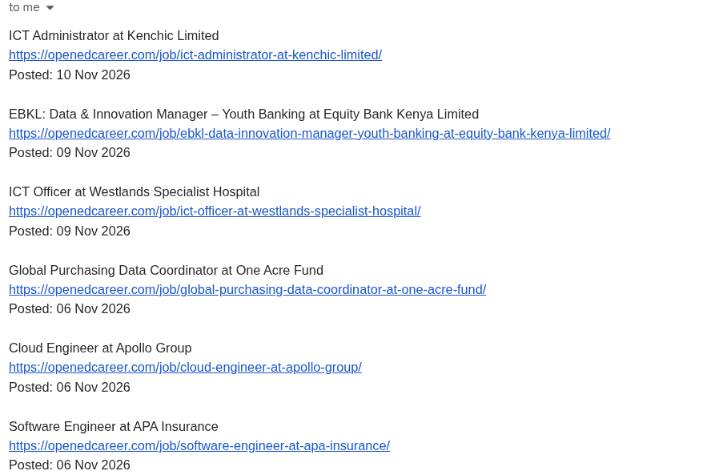

# Job Alert Bot

<One or two sentences: what it does and why you built it.>

## How it works

1. **Fetch:** <where the jobs come from and how>
2. **Filter:** <how titles are matched, and what the exclude list is for>
3. **Dedupe:** <how it avoids sending the same job twice>
4. **Notify:** <how the email is sent>
5. **Schedule:** <how it runs every day without a server>

## Design decisions

- <Why parsing is separate from fetching>
- <Why keywords match whole words only>
- <Why jobs are marked as seen only after the email is sent>
- <Why the seen file is committed back to the repo>

## Run it locally

    git clone https://github.com/mucheru-delvan/job-alert-bot.git
    cd job-alert-bot
    uv sync

Create a `.env` file:

    EMAIL_ADDRESS=your_email@gmail.com
    EMAIL_APP_PASSWORD=your_16_character_app_password

Then run:

    uv run --env-file .env python main.py

## Run the tests

    uv run pytest

## Run it on GitHub Actions

<Which two secrets to add, and where. When does it run?>

## Limitations and next steps

- <e.g. matches on job titles only, not descriptions>
- <e.g. one source so far>

## License

MIT